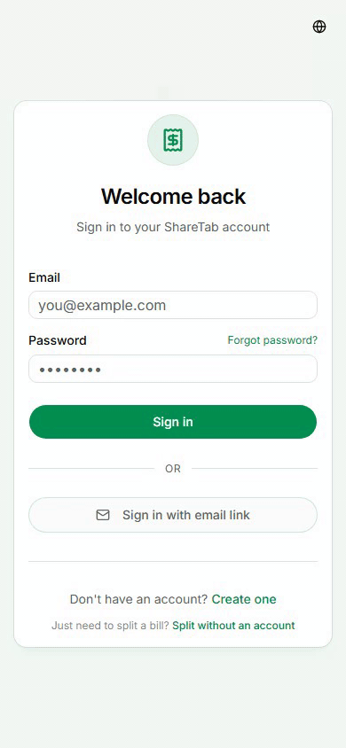
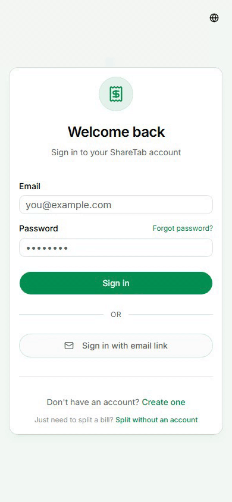
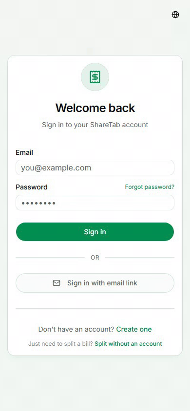
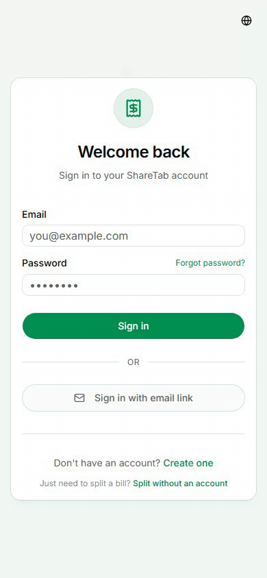
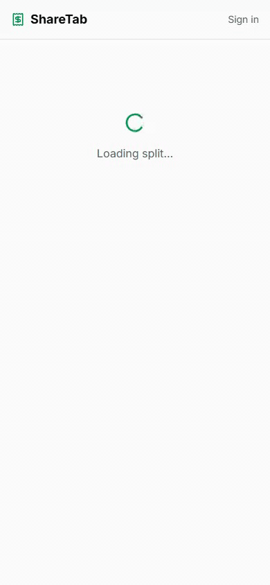
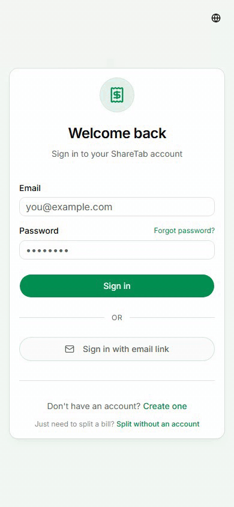
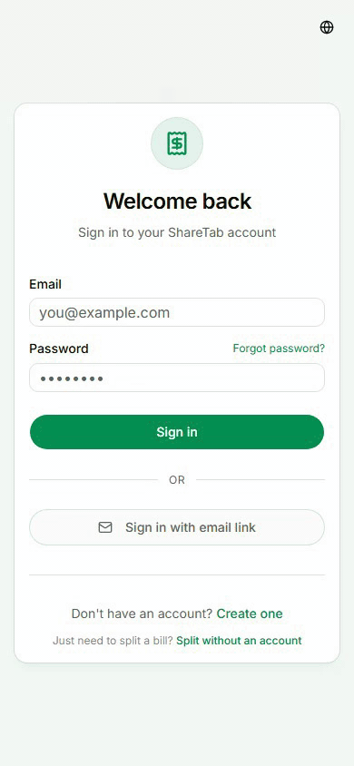
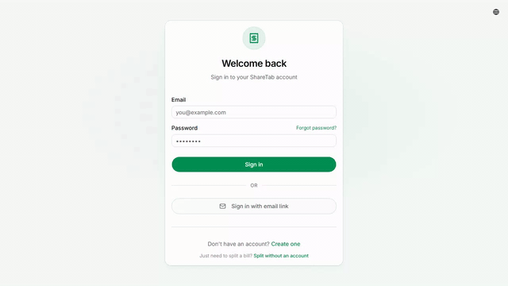

<p align="center">
  
</p>

<h1 align="center">ShareTab</h1>

<p align="center">
  A self-hosted, open-source alternative to Splitwise with AI-powered receipt scanning.
</p>

<p align="center">
  <a href="#quick-start">Quick Start</a> &bull;
  <a href="#features">Features</a> &bull;
  <a href="#screenshots">Screenshots</a> &bull;
  <a href="#configuration">Configuration</a> &bull;
  <a href="#development">Development</a>
</p>

<p align="center">
  <a href="LICENSE"></a>
  
  
</p>

---

ShareTab is a free, self-hosted alternative to Splitwise for tracking shared expenses with roommates, friends, and travel groups. Snap a photo of a receipt, let AI extract the line items, and assign them to group members. Taxes and tips split proportionally. Deploy on your own server with Docker Compose.

## Screenshots

### Dashboard -- see all your balances at a glance

<p align="center">
  
</p>

### AI receipt scanning -- snap a photo, assign items to people

<p align="center">
  
</p>

### Split modes -- equal, exact, percentage, or shares

<p align="center">
  
</p>

### Add expense -- quick and simple

<p align="center">
  
</p>

### Multi-currency -- spend in any currency, settle in the group's currency

<p align="center">
  
</p>

### Create a group -- emoji, currency, and description

<p align="center">
  
</p>

### Settle up -- click a debt to record payment

<p align="center">
  
</p>

### Venmo payments -- one tap to pay your share

<p align="center">
  
</p>

### Invite members -- share a link

<p align="center">
  
</p>

### Guest bill splitting -- no account needed

<p align="center">
  
</p>

### Group settings

<p align="center">
  
</p>

### Dark mode -- toggle with one click

<p align="center">
  
</p>

### 9 languages -- switch the entire UI in one click

<p align="center">
  
</p>

### Admin dashboard -- manage users, AI providers, and system settings

<p align="center">
  
</p>

## Features

- **Group expense tracking** with multiple split modes (equal, percentage, shares, exact, item-level)
- **AI receipt scanning** -- photograph a receipt, AI extracts line items, assign items to group members with proportional tax/tip; zoomable/pannable receipt viewer; rescan with correction prompts
- **Multi-currency** -- record an expense in any currency and ShareTab converts it to the group's currency at the exchange rate for the expense date (ECB rates from [frankfurter.app](https://frankfurter.app), no API key; the server needs outbound internet access). For a currency without an ECB rate, or when the lookup fails, enter the rate yourself (expenses created from a scanned receipt can't take a manual rate)
- **Claim sessions** -- share a scanned receipt as a link so everyone picks their own items: split an item between people, join as a couple or group that pays a proportional share, and finalize once every item is claimed. Each person gets a personal link for continuing as themselves on another device (send it only to yourself: anyone who has it can act as you in that split until the split expires, 7 days after it's created or earlier if its signed-in creator ends it, or until you're removed from it); rejoining under a name someone already took needs that person's link. Works for guest splits and group receipt scans, and signed-in users find their guest splits under **My Splits**
- **Venmo payments** -- one-tap Venmo pay links on guest split results, claim sessions, and group balances; paying a group debt records the settlement after you confirm. USD only, and off by default: an admin enables it, users add their Venmo handle in Settings, and a guest split's creator (signed in) adds theirs on the split
- **9 languages** -- English, Spanish, Swedish, French, German, Brazilian Portuguese, Japanese, Simplified Chinese, and Korean, with locale-aware money formatting; each user's choice is saved to their account
- **Guest bill splitting** -- no account needed, shareable summary links; admins can turn off guest receipt uploads (admin toggle or `DISABLE_GUEST_UPLOADS`) so anonymous visitors can't upload receipt images or run AI scans (signed-in users with an active account keep access, so also limit who can create an account: Registration Control covers password and Google sign-up, while magic link and OIDC auto-registration still create accounts; see [Security notes](#oidc-security-notes))
- **Pluggable AI providers** -- OpenAI (GPT-4o), OpenAI-Codex (ChatGPT OAuth), Claude (API key), Meridian (Claude Max subscription), local Ollama
- **Group archiving** -- archive settled-up groups to declutter your dashboard; toggle archived view on groups page. A group with an open balance can't be archived, and an archived group where you still owe or are owed money (for example, one archived before this rule) stays on the dashboard
- **Cross-group dashboard** -- see all your balances at a glance, with per-person debt breakdown
- **Debt simplification** -- minimize the number of payments needed
- **Settle up** -- record payments between any two group members with explicit From/To fields
- **Placeholder members** -- add people without accounts and rename them from group settings; when someone joins, send them a link that hands over their placeholder, or merge the placeholder into the account they joined with, and its expenses and payments move to them. Once someone has settled up, remove them: their past expenses stay under their name, and a balance that comes back can still be settled with them
- **Dark mode** -- system-aware with manual toggle
- **Invite links** -- share a link to add friends to your groups
- **Magic link auth** -- passwordless email sign-in
- **Password reset** -- "Forgot password?" emails a single-use reset link when email is configured; an admin can also make one from the admin dashboard, the way back in without email; a new password ends every session signed in under the old one (see [Forgotten passwords](#forgotten-passwords))
- **Single sign-on (OIDC)** -- sign in with Authentik, Authelia, Keycloak, or other OpenID Connect providers; optional auto-registration and password-login disable
- **Google sign-in** -- optional "Sign in with Google" button; new Google accounts follow the Registration setting
- **PWA** -- installable on mobile with app-like experience
- **Admin dashboard** -- system health (database, version and commit, uptime), user management (including password reset links), group overview, storage stats, AI usage, AI provider test, Meridian and ChatGPT OAuth login, auth-expiry email alerts, activity feed, audit log, registration control, guest receipt upload toggle, Venmo toggle, announcements, server logs, user impersonation, data export, expired guest split cleanup
- **Self-hosted** -- Docker Compose deployment, designed for Unraid

## Quick Start

ShareTab ships as an all-in-one Docker container with PostgreSQL bundled inside. No external database needed, though you can use your own (see [Using an external PostgreSQL](#external-postgres)). The bundled Compose file builds the image from your checkout of this repo:

```bash
git clone https://github.com/sw-carlos-cristobal/sharetab.git
cd sharetab/docker
cp ../.env.example .env
```

Edit `.env` with your settings -- at minimum, generate real values for `NEXTAUTH_SECRET` and `AUTH_SECRET`:

```bash
# Generate a secret
openssl rand -base64 32
```

Then build and start the container:

```bash
docker compose up -d --build
```

The app will be available at `http://localhost:3000`.

## Unraid

If you want to run ShareTab on Unraid, this repo includes a ready-made template at [unraid/sharetab.xml](unraid/sharetab.xml).

To use it:

```bash
# On your Unraid server
mkdir -p /boot/config/plugins/dockerMan/templates-user
cp /path/to/sharetab/unraid/sharetab.xml /boot/config/plugins/dockerMan/templates-user/sharetab.xml
```

Then in the Unraid web UI:

1. Open `Docker`.
2. Click `Add Container`.
3. Select the `ShareTab` template from the template dropdown.
4. Fill in the required variables like `AUTH_SECRET`, `NEXTAUTH_SECRET`, and any optional AI settings.
5. Click `Apply` to create and start the container.

You can also skip the manual copy and paste the raw template URL into Unraid's template install flow:

`https://raw.githubusercontent.com/sw-carlos-cristobal/sharetab/main/unraid/sharetab.xml`

The template runs the prebuilt `ghcr.io/sw-carlos-cristobal/sharetab:stable` image (see [Prebuilt images](#prebuilt-images)). To upgrade, click **Check for Updates** in the Docker tab, then apply the update.

<a id="backups"></a>**Backups:**

```bash
# Unraid (the template names the container "sharetab")
docker exec sharetab su-exec postgres pg_dump -U sharetab -Fc sharetab > sharetab.dump

# Docker Compose (run from the docker/ directory; the backup goes outside the checkout)
mkdir -p ~/sharetab-backup
docker compose exec -T sharetab su-exec postgres pg_dump -U sharetab -Fc sharetab > ~/sharetab-backup/sharetab.dump
```

`-Fc` writes PostgreSQL's custom format, which `pg_restore` reads (see [Restoring a backup](#restoring)); with Compose, `-T` keeps a terminal from altering the binary file. With Compose, keep backups outside your checkout of this repo: the image is built from the checkout, so a dump or a copy of the receipts inside it would go into every build. The dump holds password hashes and receipts, so keep it private (run `umask 077` first).

Note the build each backup came from, since a restore needs it. With a prebuilt image (Unraid, or Compose set up with a `ghcr.io` image), that's the first 7 characters of the `Commit:` line in the container's startup log, or of `docker exec sharetab cat /app/.commit-sha` (with Compose, `docker compose exec sharetab cat /app/.commit-sha`): the image's tag. With the Compose file that builds from your checkout, it's `git rev-parse --short HEAD` in the checkout (the image itself records `unknown`).

These commands use the default database user and name, `sharetab`; if you changed `DB_USER` or `DB_NAME`, use your values here and in the `psql` and `pg_restore` commands below. With an [external database](#external-postgres), dump that server instead: with the Compose overlay, `docker compose exec -T postgres pg_dump -U sharetab -Fc sharetab > ~/sharetab-backup/sharetab.dump`, and its data is in the `docker_postgres` volume. The dump covers the database only. A full backup also needs the receipt images (`/app/uploads`; with Compose, `rm -rf ~/sharetab-backup/uploads && docker compose cp sharetab:/app/uploads ~/sharetab-backup/uploads` copies them out, the `rm` because a copy onto an existing folder lands inside it), the AI provider logins if you use `meridian` or `openai-codex` (`/app/claude`, `/app/chatgpt`), and your settings. On Unraid the data folders are under `/mnt/user/appdata/sharetab/` and the template settings are on the flash drive (`/boot/config/plugins/dockerMan/templates-user/`); with Compose the data is in the `docker_uploads`, `docker_claude`, and `docker_chatgpt` named volumes (Compose prefixes volume names with the project name, `docker` by default; `docker volume ls` lists them) and the settings are in `docker/.env` (also keep a copy of `docker/docker-compose.yml` if you edited it, for example to use a prebuilt image).

Files can change between the dump and the copy while people use ShareTab. For a backup where everything matches, stop the container and copy all of its data while it is stopped: on Unraid the whole `/mnt/user/appdata/sharetab/` folder (it includes the database files in `db/`), with Compose the `docker_pgdata`, `docker_uploads`, `docker_claude`, and `docker_chatgpt` volumes. Keep file ownership when you copy (`cp -a` or `rsync -a`), or PostgreSQL can't read its files after a restore. With an [external database](#external-postgres) the database files aren't in those folders: stop that server too and copy its own storage (the `docker_postgres` volume with the Compose overlay).

<a id="restoring"></a>**Restoring a backup:**

Restore onto the build the backup came from, or a newer one, which upgrades the restored data when it starts, as any upgrade does; an older build may not start on it (see [Upgrading](#upgrading)). To run a given build, use its prebuilt image, `ghcr.io/sw-carlos-cristobal/sharetab:<sha>` with the 7-character commit you noted (see [Prebuilt images](#prebuilt-images); on Unraid, in the container's **Repository** field), or, with the Compose file that builds from your checkout, `git checkout <sha>` first.

_From a copy of the stopped container's data:_ this replaces everything in those folders now. Check the copy first (on Unraid, `/path/to/copy/sharetab/` should hold `db/PG_VERSION` and `uploads/receipts/`). Then stop the container, replace each folder or volume with its copy, and start it again. Delete what's there rather than copying over it, so nothing newer is left beside the copy, and keep file ownership: `rsync -a --delete <copy>/ <folder>/`. On Unraid that's `rsync -a --delete /path/to/copy/sharetab/ /mnt/user/appdata/sharetab/`; with Compose, `docker volume inspect -f '{{ .Mountpoint }}' docker_pgdata` (and likewise for the other volumes) shows where each volume's folder is on the Docker host. With an external database, put back that server's storage too. If your settings changed since the backup, put back the template or `docker/.env` as well.

_From a dump_, into an existing install or a fresh one, while nobody is using ShareTab. Steps 1 to 3 need maintenance mode, which builds from #427 on have, so run them on such a build at least as new as the backup (the current build always is). Maintenance mode leaves the schema alone, so in step 4 you can switch to the backup's own build.

1. Start the container in **maintenance mode**, which runs the bundled database without ShareTab, so nothing else is connected while you restore. On Unraid, edit the container, set **Maintenance mode** (advanced view) to `true`, and click **Apply**; on a fresh install, set it in **Add Container** before the first **Apply**. A container made from an older template has no such field: add it with **Add another Path, Port, Variable** (Config Type **Variable**, Key `SHARETAB_MAINTENANCE`, Value `true`). With Compose, from `docker/` (on a fresh install, with the [Quick Start](#quick-start)'s `.env` in place): `SHARETAB_MAINTENANCE=true docker compose up -d --build`. With `sudo`, which drops your shell's variables, put `SHARETAB_MAINTENANCE=true` in `docker/.env` instead. A `docker-compose.yml` you edited before maintenance mode existed needs the line `- SHARETAB_MAINTENANCE=${SHARETAB_MAINTENANCE:-}` under `environment:`.

   Don't go on until the log shows maintenance mode: `docker logs sharetab 2>&1 | grep 'ShareTab maintenance mode'` (with Compose, `docker compose logs sharetab | grep 'ShareTab maintenance mode'`) must print the line. If it prints nothing, ShareTab is running: the build has no maintenance mode, or the variable didn't reach the container. On a fresh install, this first start creates the empty database. Docker reports the container as unhealthy until you leave maintenance mode.

2. Check that the dump reads (an empty or half-written file fails here), then replace the database with an empty one and load the dump into it. **This deletes the current database**; to keep it, dump it to another file first. Replacing the database rather than loading over it is what makes the result exactly the backup: anything added since, tables a newer build made included, goes with the old database.

   ```bash
   # Unraid
   docker exec -i sharetab pg_restore -f /dev/null < sharetab.dump && echo "dump OK"
   docker exec sharetab su-exec postgres psql -v ON_ERROR_STOP=1 -c 'DROP DATABASE sharetab' -c 'CREATE DATABASE sharetab OWNER sharetab'
   docker exec -i sharetab su-exec postgres pg_restore -U sharetab -d sharetab --no-owner --no-privileges --single-transaction < sharetab.dump

   # Docker Compose (run from the docker/ directory)
   docker compose exec -T sharetab pg_restore -f /dev/null < ~/sharetab-backup/sharetab.dump && echo "dump OK"
   docker compose exec -T sharetab su-exec postgres psql -v ON_ERROR_STOP=1 -c 'DROP DATABASE sharetab' -c 'CREATE DATABASE sharetab OWNER sharetab'
   docker compose exec -T sharetab su-exec postgres pg_restore -U sharetab -d sharetab --no-owner --no-privileges --single-transaction < ~/sharetab-backup/sharetab.dump
   ```

   If `DROP DATABASE` says the database `is being accessed by other users`, ShareTab is running: go back to step 1. The load is all or nothing: if `pg_restore` fails on a dump that passed the check, fix the cause and run the last two commands again. A plain-SQL dump (`backup.sql`, from the `pg_dump` command without `-Fc` this README gave before) is checked by its last lines, which must include `PostgreSQL database dump complete` (only an `\unrestrict` line may follow it), and loads with `psql` in place of `pg_restore`: `docker exec -i sharetab su-exec postgres psql -U sharetab -d sharetab -1 -v ON_ERROR_STOP=1 < backup.sql` (with Compose, `docker compose exec -T sharetab ...`).

3. Put back the receipt images. This deletes the ones there now, so check the copy first: it should have a `receipts` folder. On Unraid: `rsync -a --delete /path/to/copy/uploads/ /mnt/user/appdata/sharetab/uploads/`. With Compose, from `docker/`: `ls ~/sharetab-backup/uploads/receipts | head`, then `docker compose exec sharetab sh -c 'rm -rf /app/uploads/*'` and `docker compose cp ~/sharetab-backup/uploads/. sharetab:/app/uploads/`. On a fresh install that uses `meridian` or `openai-codex`, put back `/app/claude` or `/app/chatgpt` the same way (with Compose, then run `docker compose exec sharetab chown -R nextjs:nodejs /app/claude /app/chatgpt`: copied files belong to root, and the app can't read them otherwise), or sign in again from the admin dashboard.
4. Leave maintenance mode on the build you want to run: on Unraid, clear **Maintenance mode** (and change **Repository** to switch builds) and click **Apply**; with Compose, remove `SHARETAB_MAINTENANCE` from `docker/.env` if you put it there, `git checkout <sha>` to switch builds, and run `docker compose up -d --build`. ShareTab starts on the restored data.

With an [external database](#external-postgres), maintenance mode starts nothing: the container stays up without ShareTab, so it holds no connections while you restore that server. In step 2, check the dump, replace the database there with an empty one owned by ShareTab's user, and load the dump with a `pg_restore` at least as new as the `pg_dump` that wrote it, with the same options. With the Compose overlay, from `docker/`:

```bash
docker compose exec -T postgres pg_restore -f /dev/null < ~/sharetab-backup/sharetab.dump && echo "dump OK"
docker compose exec -T postgres psql -U sharetab -d postgres -v ON_ERROR_STOP=1 -c 'DROP DATABASE sharetab' -c 'CREATE DATABASE sharetab'
docker compose exec -T postgres pg_restore -U sharetab -d sharetab --no-owner --no-privileges --single-transaction < ~/sharetab-backup/sharetab.dump
```

<a id="external-postgres"></a>

## Using an external PostgreSQL

To run PostgreSQL yourself (its own container, a Kubernetes operator, a managed service), set `DATABASE_URL` on the ShareTab container. With it set, the container doesn't initialize or start its bundled database, and ignores `DB_USER`, `DB_PASSWORD` and `DB_NAME`. Leave it unset (or empty) to keep the bundled one.

```
DATABASE_URL=postgresql://sharetab:<password>@<host>:5432/sharetab
```

For a server on another machine, add TLS (see below), or the app's connection is sent unencrypted.

- **Give ShareTab a database of its own.** ShareTab creates its tables, enum types and indexes on first start, not the database. Its schema step drops empty tables it doesn't know, and won't start while such a table holds rows, so startup refuses a database whose `public` schema holds tables ShareTab doesn't have, an extension's tables (PostGIS's, say) included. The user needs to own the database (PostgreSQL 15 and newer don't let other users create tables in its `public` schema). Docker and CI use PostgreSQL 16.
- **Percent-encode** any of `: / ? # @ [ ] %` in the user name or password (`/` is `%2F`), or use a password of letters and digits. Startup says so when the URL can't be read. Use a host and port (a Unix socket isn't supported) and leave out `?schema=`: ShareTab uses the `public` schema.
- **Startup waits for the server**, up to `DB_WAIT_SECONDS` (default 60), while it is unreachable or still starting, so starting both at once is fine. A wrong password, a missing database, a `pg_hba.conf` rejection or an untrusted certificate stops startup at once, with the reason and what to change in the log. Docker's health check gives startup 60 seconds before counting failures, so with a much longer `DB_WAIT_SECONDS` the container shows as unhealthy while it waits, and tools that restart unhealthy containers will restart it.
- **TLS:** no `sslmode` connects without TLS, unless `PGSSLMODE` is set in the container; `sslmode=disable` never uses it. To use TLS and check the server's certificate, mount the CA certificate into the container (readable by the app's user, uid 1001), set `NODE_EXTRA_CA_CERTS` to its path, and use `?sslmode=verify-full` with the host name the certificate was issued for (an IP address doesn't work). `?sslmode=no-verify` encrypts without checking who answers, so use it only on a network you trust. `sslmode=require` checks the certificate too, unlike in `psql`, so it fails on a self-signed one. The schema step at startup (`prisma db push`) uses Prisma's own connection: unless `sslmode=disable`, it uses TLS when the server offers it (with no `sslmode` too), and it doesn't check the certificate: `verify-full` covers the app and ShareTab's own startup checks, not that step. (Prisma's `sslaccept=strict` makes it check, against its own trust store rather than `NODE_EXTRA_CA_CERTS`; ShareTab isn't tested with it.)
- **Docker Compose:** `docker/docker-compose.external-db.yml` runs `postgres:16-alpine` in its own container and sets `DATABASE_URL` for you, from `DB_USER`, `DB_PASSWORD` and `DB_NAME` in `docker/.env`. Compose can't percent-encode, so keep all three to letters, digits and `_`, with `DB_PASSWORD` from `openssl rand -hex 24`; the overlay requires it. They take effect when the overlay's database is first created: changing them later doesn't change it (for a new password, `ALTER ROLE ... PASSWORD` in the database; for a new user or database name, start over with an empty `postgres` volume). The overlay's user is the database server's superuser, which is fine for a server only ShareTab uses; for a shared one, use your own server and give ShareTab a role of its own. To use a PostgreSQL server of your own with Compose instead, set `DATABASE_URL` in the `sharetab` service's `environment` in a `docker-compose.override.yml`: a `DATABASE_URL` in `docker/.env` doesn't reach the container. Add this line to `docker/.env` so every `docker compose` command, including upgrades, uses the overlay (on Windows, separate the files with `;`). Setting `COMPOSE_FILE` stops Compose reading `docker-compose.override.yml` on its own: if you have one, add it to the list (`docker-compose.yml:docker-compose.override.yml:docker-compose.external-db.yml`).

  ```
  COMPOSE_FILE=docker-compose.yml:docker-compose.external-db.yml
  ```

- **Unraid:** fill in **Database URL** (under advanced settings).
- **Kubernetes with CloudNativePG:** use the `uri` key of the cluster's `<cluster>-app` secret. Mount volumes at `/var/lib/postgresql/data` (it holds the marker below) and `/app/uploads` (receipt images), and at `/app/claude` and `/app/chatgpt` if you use the Meridian or ChatGPT providers (their logins): Kubernetes doesn't keep the image's own volumes. Run one replica with the `Recreate` strategy (every start applies the schema), let the container start as root with a writable root filesystem (the entrypoint sets up folders, then switches to its own users), and give a startup probe `DB_WAIT_SECONDS` plus a few minutes for the schema step. Use `/api/health` for readiness, not liveness: it fails while the database is down, and restarting ShareTab then doesn't help.

Once ShareTab has run on an external database, the container keeps a file named `.sharetab-external-database` in the bundled database's folder (`/var/lib/postgresql/data`; on Unraid `/mnt/user/appdata/sharetab/db`). If the container is later started without `DATABASE_URL` (say, a Compose command run without the overlay file, or a cleared Unraid field), it refuses to start rather than run on an empty bundled database. This needs that folder to be a volume that outlives the container.

To go back to the bundled database on purpose, delete that file (with Compose, from `docker/`: `docker compose run --rm --no-deps --entrypoint rm sharetab /var/lib/postgresql/data/.sharetab-external-database`). The bundled database then has what it had before the switch, if anything. To take the newer data back with you, while nobody is using ShareTab (this needs an external server on PostgreSQL 16 or older, since the bundled one is 16):

1. Copy the bundled database's folder somewhere safe (see [Backups](#backups)); step 3 deletes what's in it.
2. Dump the external database with PostgreSQL 16's `pg_dump`, keeping the dump private (`umask 077` first) and with `PGPASSWORD` exported in your shell (`read -rs PGPASSWORD; export PGPASSWORD`); `<host>` must be reachable from a container, so not `localhost`: `docker run --rm -e PGPASSWORD postgres:16-alpine pg_dump --no-owner --no-privileges -h <host> -U sharetab sharetab > sharetab.sql` (with the Compose overlay, from `docker/`: `docker compose exec -T postgres pg_dump --no-owner --no-privileges -U sharetab sharetab > sharetab.sql`). Check that it has a `PostgreSQL database dump complete` line near the end (only an `\unrestrict` line follows it).
3. Delete the marker, unset `DATABASE_URL` (or remove `COMPOSE_FILE` from `docker/.env`), set `DB_USER`, `DB_PASSWORD` and `DB_NAME` back to the values the bundled database was created with (`sharetab` if you never set them), start ShareTab on the bundled database, and replace that database with an empty one: `docker exec sharetab su-exec postgres psql -c 'DROP DATABASE sharetab WITH (FORCE)' -c 'CREATE DATABASE sharetab OWNER sharetab'` (with Compose, `docker compose exec sharetab ...` from `docker/`; use your `DB_NAME` and `DB_USER`).
4. Load the dump in one transaction, then restart ShareTab: `docker exec -i sharetab su-exec postgres psql -U sharetab -d sharetab -1 -v ON_ERROR_STOP=1 < sharetab.sql` (with Compose, `docker compose exec -T sharetab ...`). The image's `psql` reads the dump's `\restrict` line. If the load fails, nothing is loaded: fix the cause and load it again.

<a id="moving-to-external"></a>

### Moving to an external database

Setting `DATABASE_URL` doesn't copy anything. So that a wrong URL or a forgotten copy doesn't start ShareTab empty beside your data, a start on an empty external database is refused while the container's data folder still holds a bundled database and ShareTab hasn't run on an external one yet. Copy your data first, as below, or, to start with no data, set `ALLOW_EMPTY_EXTERNAL_DB=true` for that start (on Unraid, **Allow empty external database**; with Compose, in `docker/.env`; with `docker run`, `-e`). To keep your data, copy it before ShareTab first starts on the new server, while nobody is using ShareTab (changes made after the dump aren't copied). The dump holds password hashes and receipts, so keep it private (`umask 077` first) and delete it afterwards:

1. Take a full backup (see [Backups](#backups)).
2. Create the database and its user on the new server.
3. Dump the bundled database, leaving out ownership and permissions, which belong to the old user. On Unraid: `docker exec sharetab su-exec postgres pg_dump -U sharetab --no-owner --no-privileges sharetab > sharetab.sql`. With Compose, from `docker/`: `docker compose exec -T sharetab su-exec postgres pg_dump -U sharetab --no-owner --no-privileges sharetab > sharetab.sql`.
4. Stop ShareTab.
5. Load the dump into the new database as its user (with `PGPASSWORD` set in your shell, so the password stays out of your history: `read -rs PGPASSWORD; export PGPASSWORD`): `psql -h <host> -U sharetab -d sharetab -1 -v ON_ERROR_STOP=1 -f sharetab.sql` (`-1` loads it in one transaction, so a failed load leaves the database empty to try again). The dump starts with a `\restrict` line that `psql` older than 13.22, 14.19, 15.14, 16.10 or 17.6 rejects; without a new enough `psql`, use the one in the PostgreSQL image: `docker run --rm -i -e PGPASSWORD postgres:16-alpine psql -h <host> -U sharetab -d sharetab -1 -v ON_ERROR_STOP=1 < sharetab.sql`. With the Compose overlay, set `COMPOSE_FILE` as above, start only the database and wait for it, then load the dump with its own `psql`: `docker compose up -d --wait postgres`, then `docker compose exec -T postgres psql -U sharetab -d sharetab -1 -v ON_ERROR_STOP=1 < sharetab.sql`.
6. Set `DATABASE_URL` (or `COMPOSE_FILE`) and start ShareTab.

Loading the dump after ShareTab has started on the new database fails, because ShareTab has already created empty tables there. Once everything is there, you can delete the old database files, but keep `.sharetab-external-database`.

## Upgrading

Before upgrading:

1. Take a full backup (see [Backups](#backups)).
2. Read the sections below: any upgrade that needs a manual step is described there. The [build releases](../../releases) list every commit since the build you run.
3. Compare `.env.example` with your `.env` (or the Unraid template) for new variables.

Going back to an older build isn't supported once a newer one has changed the database schema: on start, `prisma db push` can refuse to drop the newer columns, and the container won't start. [Restore the backup](#restoring) you took before upgrading instead, onto the build it came from. On an external database, the older build refuses to start on the newer tables: restore the backup into that database rather than pointing ShareTab at a new one.

The bundled Compose file builds the image from your checkout, so upgrade by updating the checkout and rebuilding. From the `docker/` directory:

```bash
git pull
docker compose up -d --build
```

`docker compose pull` alone doesn't upgrade this setup: the image is built locally, not pulled.

### Prebuilt images

Each push to `main` starts an image build; each build that passes its smoke test is published to the GitHub Container Registry. To run a prebuilt image instead of building one, replace the `build:` block and `image: sharetab:latest` in `docker/docker-compose.yml` with one of these tags, then upgrade from the `docker/` directory with `docker compose pull && docker compose up -d`:

| Tag                                           | What it is                                                                                                                                                                                                                      |
| --------------------------------------------- | ------------------------------------------------------------------------------------------------------------------------------------------------------------------------------------------------------------------------------- |
| `ghcr.io/sw-carlos-cristobal/sharetab:stable` | A build the maintainer has promoted as stable. Recommended; the Unraid template uses this tag. It can lag `main`, so a feature described in this README may not be in it yet.                                                   |
| `ghcr.io/sw-carlos-cristobal/sharetab:latest` | The newest build from `main` that passed its smoke test, whether or not it has been promoted, so it can include changes that haven't been tried outside CI. It can lag the newest commit while a build runs or after one fails. |
| `ghcr.io/sw-carlos-cristobal/sharetab:<sha>`  | One specific commit (short SHA, e.g. `870a80e`), for pinning. A push that lands while the previous build is still running cancels that build, so not every commit has an image.                                                 |

Each push to `main` also gets a GitHub release named `Build YYYY.MM.DD.N-<sha>` listing the changes since the previous build; see [Releases](../../releases). The `stable` git tag normally marks the commit `:stable` was built from ([browse it](../../tree/stable)); after a failed promotion (see [Releases](#releases)) the tag and the image can point at different commits. ShareTab no longer publishes numbered (semver) versions; the last was v0.8.0.

### Codex model default (#481)

- `OPENAI_CODEX_MODEL` now defaults to `gpt-6.1-sol`. OpenAI retired `gpt-5.5`, the previous default, from Codex for ChatGPT sign-in on 2026-10-14 ([Codex models](https://learn.chatgpt.com/docs/models)), and the backend refuses it with `400 model_not_found`, so receipt scans through `openai-codex` fall through to the next provider, or fail outright when it is the only one. A value saved in your `.env` or Unraid template is kept on upgrade, so change a saved value the backend refuses (such as `gpt-5.4`, `gpt-5.5` or `gpt-6.1`) to `gpt-6.1-sol`, or blank it to use the default.
- `gpt-6.1-sol` isn't open to every ChatGPT plan, and ShareTab has only been tested with it on Plus. Enterprise and Edu workspaces keep it off until an administrator enables it ([workspace model availability](https://learn.chatgpt.com/docs/enterprise/workspace-model-availability)). On Free and Go, OpenAI documents Codex only in its desktop app ([pricing](https://learn.chatgpt.com/docs/pricing)), so the `openai-codex` provider may not work there at all; use another provider.

### External PostgreSQL (#464)

- `DATABASE_URL` set on the container now turns the bundled database off (see [Using an external PostgreSQL](#external-postgres)). Before, the container used the URL but started the bundled server anyway. If you set `DATABASE_URL` to point at the bundled server (`localhost:5432`), remove it: nothing listens there now. Startup says so at once, and stops after `DB_WAIT_SECONDS`.
- The entrypoint waits for the database and runs the SQL in `prisma/migrations/` and `prisma/after-push/` through the app's own database driver instead of `psql`, and refuses some URLs the app and Prisma would read differently (the schema step, `prisma db push`, still uses Prisma's own driver). The startup summary's `Database:` line now shows the mode and `host:port/database`.
- With `DATABASE_URL` set, startup refuses a database whose `public` schema holds tables ShareTab doesn't have, and writes `.sharetab-external-database` into `/var/lib/postgresql/data`, which must be a writable volume that outlives the container (startup stops if it can't write it). An install that already set `DATABASE_URL` warns once that the bundled database in that folder isn't used: the old entrypoint created it anyway, with no ShareTab data in it.
- A bundled `DB_NAME` with `/`, `?` or `#` in it now stops startup with a message: the app's driver and Prisma would read such a database URL differently.
- Unraid: an existing container keeps Docker's default 10-second stop timeout, which can cut short the bundled database's shutdown. Add `--stop-timeout=30` to **Extra Parameters** (advanced view), as new installs from the template have.

### Password reset (#397)

- **Forgot password?** on the login page now opens a page that emails a reset link when email is configured, and otherwise tells people to ask the administrator; the admin dashboard's User Management makes such links (see [Forgotten passwords](#forgotten-passwords)). Set `NEXTAUTH_URL` to your public URL: emailed links are built from it.
- Setting a new password, with a link or in Settings, ends every session signed in under the old one. Sessions from before the upgrade keep working until that user's password changes. While the database can't be read, signed-in pages and calls are refused, but nobody is signed out: the session works again once the database is back.
- `AUTH_RATE_LIMIT_MAX` now also limits wrong current passwords in Settings, and `DISABLE_PASSWORD_LOGIN` now also turns off password changes there.
- With email configured, a reset or a password change emails the account a "password changed" notice.

### Email settings (#397)

- An empty `EMAIL_FROM`, `EMAIL_SERVER_USER` or `EMAIL_SERVER_PASSWORD` now counts as unset: an empty `EMAIL_FROM` no longer replaces the default sender, and empty credentials no longer make ShareTab try to log in to the SMTP server.
- The links in emails ShareTab builds itself (auth-expiry alerts) use the origin of `AUTH_URL`, then `NEXTAUTH_URL`. A value that isn't an http(s) URL stops those emails, logged as `mail.public_url_invalid`.
- Starting a Meridian login from the admin dashboard returns its login link even when the email about it can't be sent.

### Google sign-in button (#360)

- With `GOOGLE_CLIENT_ID` and `GOOGLE_CLIENT_SECRET` set, the login page now shows a **Sign in with Google** button.
- New Google accounts now follow the admin **Registration** setting and need an email Google has verified: _Closed_ and _Invite Only_ refuse them, where before any Google user whose email had no account got one. Accounts already linked to Google keep signing in. If you rely on Google sign-up, keep Registration Mode _Open_ and see _Google sign-in_ for what that also opens.
- `DISABLE_PASSWORD_LOGIN` doesn't close Google sign-up: on an SSO-only instance with Google set up, anyone with a Google account (as far as the Google app's audience allows) can create an account while Registration Mode is _Open_, the default. Set it to _Closed_ if Google should only sign in existing accounts (`OIDC_AUTO_REGISTER` and magic link still create accounts).
- A Google sign-in for an address that already has an account is still refused, now with "Sign in the way you usually do…". A Google sign-in while anyone is signed in on that browser is now refused unless that Google account is already theirs; before, a Google account not yet linked to any account was linked to whoever was signed in (the only way to add Google to an existing account). Creating the `ADMIN_EMAIL` account through Google needs a `@gmail.com` address or one in a Google Workspace or Cloud Identity domain.
- OIDC email linking (`OIDC_ALLOW_EMAIL_LINKING`) no longer links an account that has a Google identity.

### AI model defaults and Meridian (builds from 2026.09.26)

- `OPENAI_CODEX_MODEL` now defaults to `gpt-5.5` (build `2026.09.26.2`, #211): the Codex backend rejects `gpt-5.4` for ChatGPT accounts. The old `.env.example` and Unraid template set `gpt-5.4` explicitly, and a saved value is kept on upgrade, so change it in your `.env` or template, or blank it to use the default (#222; builds before that fix sent a blank value as the model name instead of falling back). `gpt-5.5` has since been refused too: see _Codex model default_ above for the current value.
- `ANTHROPIC_MODEL` now defaults to `claude-sonnet-5` for both the `claude` and `meridian` providers (build `2026.09.26.3`, #215). A value saved in your `.env` or template (the old defaults were `claude-sonnet-4-6` and, on Unraid, `claude-opus-4-6`) still wins; change it if you want the new default.
- Meridian receipt scanning was broken in the Docker image in builds `2026.09.19.4` through `2026.09.26.1` and is fixed in `2026.09.26.2` (#211). If Meridian stopped working in that period, upgrading fixes it.

### Removed OCR provider

The `ocr` receipt provider was removed in build `2026.05.16.1` (#143). Before that, ShareTab fell back to OCR automatically whenever no other provider worked, and the default was `openai,ocr`. If none of your other providers works (for example the default `openai` with no `OPENAI_API_KEY`, or `meridian` that was never logged in), receipt scanning stops working after the upgrade. Configure a working provider first (see [AI Receipt Scanning](#ai-receipt-scanning)).

### Database changes on upgrade

The entrypoint automatically runs any SQL migration files in `prisma/migrations/` before applying the Prisma schema, and the files in `prisma/after-push/` after it. Most upgrades are fully automatic.

### Manual migration: GuestSplit status enum (builds after v0.8.0)

Builds after v0.8.0 (#127) added an `updatedAt` column and converted the `status` column from text to an enum on the `GuestSplit` table. This migration now runs automatically on container startup. If you need to run it manually:

```bash
# Unraid
docker exec sharetab su-exec postgres psql -U sharetab -d sharetab \
  -f /app/prisma/migrations/guest_split_status_enum.sql

# Docker Compose (run from the docker/ directory)
docker compose exec sharetab su-exec postgres psql -U sharetab -d sharetab \
  -f /app/prisma/migrations/guest_split_status_enum.sql

# External database (uses the container's DATABASE_URL; with Compose, `docker compose exec sharetab`)
docker exec sharetab node /app/db.mjs run /app/prisma/migrations/guest_split_status_enum.sql
```

This is idempotent — safe to run more than once.

<a id="email-case-uniqueness"></a>

### Accounts whose emails differ only in letter case

The database rejects a new account whose email matches an existing one ignoring case (`Alice@example.com` and `alice@example.com`). The index that enforces this is created on startup, but it can't be created while such accounts already exist, which older versions allowed. In that case ShareTab starts normally and the container log shows a warning listing the affected addresses:

```
WARNING:  Case-insensitive email uniqueness is not enforced yet: more than one account uses each of these addresses in different letter cases: alice@example.com. ...
```

In the admin dashboard, delete the account the person no longer uses (its expenses stay in their groups under "Deleted user"). The index is created on the next start, or right away with:

```bash
# Unraid
docker exec sharetab su-exec postgres psql -U sharetab -d sharetab \
  -f /app/prisma/after-push/user_email_lower_unique.sql

# Docker Compose (run from the docker/ directory)
docker compose exec sharetab su-exec postgres psql -U sharetab -d sharetab \
  -f /app/prisma/after-push/user_email_lower_unique.sql

# External database (uses the container's DATABASE_URL; with Compose, `docker compose exec sharetab`)
docker exec sharetab node /app/db.mjs run /app/prisma/after-push/user_email_lower_unique.sql
```

## Configuration

All configuration is done through environment variables. Copy `.env.example` to `.env` and adjust as needed.

### Required

| Variable          | Description                                                      |
| ----------------- | ---------------------------------------------------------------- |
| `NEXTAUTH_SECRET` | Session encryption key. Generate with `openssl rand -base64 32`. |
| `AUTH_SECRET`     | Auth.js secret. Generate the same way.                           |

### AI Receipt Scanning

| Variable                 | Description                                                                                                                                                                                                        |
| ------------------------ | ------------------------------------------------------------------------------------------------------------------------------------------------------------------------------------------------------------------ |
| `AI_PROVIDER_PRIORITY`   | Comma-separated provider priority list (for example `openai-codex,meridian,openai`). ShareTab checks providers in order, uses the first available one, and falls through to the next provider if extraction fails. |
| `OPENAI_API_KEY`         | Required when `openai` is included in `AI_PROVIDER_PRIORITY`.                                                                                                                                                      |
| `OPENAI_MODEL`           | OpenAI model for receipt scanning. Defaults to `gpt-4o`.                                                                                                                                                           |
| `OPENAI_CODEX_MODEL`     | Model for ChatGPT OAuth / Codex backend receipt scanning. Defaults to `gpt-6.1-sol`; not every ChatGPT plan can use it, see _Codex model default_ under Upgrading.                                                 |
| `ANTHROPIC_API_KEY`      | Required when `claude` is included in `AI_PROVIDER_PRIORITY`.                                                                                                                                                      |
| `ANTHROPIC_MODEL`        | Claude model for receipt scanning (claude and meridian providers). Defaults to `claude-sonnet-5`.                                                                                                                  |
| `ANTHROPIC_HEALTH_MODEL` | Model for health-check probes (auth verification). Defaults to `claude-haiku-4-5-20251001`.                                                                                                                        |
| `MERIDIAN_PORT`          | Port for the embedded Meridian proxy. Defaults to `3457`.                                                                                                                                                          |
| `OLLAMA_BASE_URL`        | Ollama server URL. Defaults to `http://localhost:11434`.                                                                                                                                                           |
| `OLLAMA_MODEL`           | Ollama model name. Defaults to `llava`.                                                                                                                                                                            |

The defaults above are what ShareTab uses when a variable is unset. The Unraid template's `OLLAMA_BASE_URL` is a placeholder (`http://192.168.1.x:11434`) to replace with your Ollama host. With Docker Compose, the values in `docker/.env` win for the variables `docker-compose.yml` passes to the container (a variable exported in your shell wins over `.env`; others in `.env`, such as `DATABASE_URL`, are ignored, and the [external-database overlay](#external-postgres) sets its own); the fallbacks in `docker-compose.yml` apply only to variables left unset or empty. `UPLOAD_DIR` is the exception: the Compose file fixes it at `/app/uploads`.

**Using `ollama` in Docker:** `localhost` inside the container is the container itself, so set `OLLAMA_BASE_URL` to the address of the machine running Ollama.

The `openai-codex` provider uses ChatGPT OAuth via the Codex backend instead of an API key. Auth data lives in `/app/chatgpt`, so if that path is on a persistent volume the login survives restarts and image updates.

After the container is running, open the ShareTab admin dashboard and complete the ChatGPT OAuth flow there:

1. Sign in as the admin user and open `/admin`.
2. In the ChatGPT OAuth section, start the login flow.
3. Authorize with ChatGPT in your browser.
4. When the flow redirects to `http://localhost:1455/auth/callback`, copy the full URL from the browser address bar and paste it back into ShareTab.

If you use your own Docker or Unraid template, mount a persistent path to `/app/chatgpt` when `openai-codex` is in `AI_PROVIDER_PRIORITY`.

The `meridian` provider uses a Claude Max/Pro subscription via an embedded proxy -- no API key needed. Claude login data lives in `/app/claude`, so if that path is on a persistent volume the login survives restarts and image updates.

After the container is running, open the ShareTab admin dashboard and complete the Meridian login flow there:

1. Sign in as the admin user and open `/admin`.
2. In the Meridian auth section, start the login flow.
3. Authorize with Claude in your browser.
4. Copy the full callback URL from the browser address bar and paste it back into ShareTab.

The bundled Docker Compose setup persists `/app/claude` automatically. If you use your own Docker or Unraid template, mount a persistent path to `/app/claude`.

**⚠️ OCR provider (removed):** The `ocr` provider (Tesseract.js) was originally included as a free fallback for users without AI API access, but after extensive testing across hundreds of real-world receipts, the accuracy was too unreliable for production use. Common failures included extracting modifiers as line items, failing to exclude delivery fees, and poor handling of non-standard receipt layouts. The OCR provider has been removed from the codebase. `ocr` in `AI_PROVIDER_PRIORITY` is now ignored, and nothing falls back to OCR any more. With `ocr` on its own there is no provider: ShareTab still starts (the container log shows `app.startup.failed`), but receipt scans fail. If you need reliable receipt scanning, configure one of the AI providers above (openai-codex or meridian are recommended). Community contributions to reintroduce OCR with improved accuracy are welcome.

### AI Provider Performance

Benchmarked on a set of receipt photos (grocery, coffee shop, restaurant) in April 2026, before the current model defaults (`gpt-6.1-sol` for Codex, `claude-sonnet-5` for Claude). Results represent typical single-receipt extraction. The Meridian row is from #215, which measured the current default, `claude-sonnet-5`.

| Provider                         | Speed        | Item Accuracy                  | Cost                                | Notes                                                                 |
| -------------------------------- | ------------ | ------------------------------ | ----------------------------------- | --------------------------------------------------------------------- |
| **OpenAI Codex** (ChatGPT OAuth) | ~6 s (April) | 5/5 items                      | Free (uses ChatGPT subscription)    | **Recommended.** Best balance of speed and accuracy.                  |
| **Meridian** (Claude OAuth)      | 7–10 s       | Every total right (3 receipts) | Free (uses Claude Max subscription) | With `claude-sonnet-5`; the April run with an older model took ~16 s. |
| **OpenAI** (API key)             | ~4 s         | 5/5 items                      | Pay-per-token                       | Fastest, but requires an API key and costs money.                     |
| **Ollama** (local LLM)           | Varies       | Varies                         | Free, fully local                   | Depends on model and hardware. Requires a running Ollama server.      |

**Recommendation:** Use `openai-codex` as your primary provider. It delivers the same accuracy as API-key providers at no additional cost (it piggybacks on your existing ChatGPT Plus/Pro subscription). Set your priority to:

```
AI_PROVIDER_PRIORITY="openai-codex"
```

If you also have a Claude Max subscription, you can add `meridian` as a fallback:

```
AI_PROVIDER_PRIORITY="openai-codex,meridian"
```

### Google sign-in (optional)

| Variable               | Description                  |
| ---------------------- | ---------------------------- |
| `GOOGLE_CLIENT_ID`     | Google OAuth client ID.      |
| `GOOGLE_CLIENT_SECRET` | Corresponding client secret. |

Setting both adds a **Sign in with Google** button to the login page; with only one set, Google stays off and the log says which is missing. Create an OAuth client of type _Web application_ in the Google Cloud console and add `<NEXTAUTH_URL>/api/auth/callback/google` (e.g. `https://sharetab.example.com/api/auth/callback/google`) as an authorized redirect URI. Google only accepts an `https` redirect URI on a public domain name, one ending in a real top-level domain such as `.com` (`localhost` and loopback addresses such as `127.0.0.1` are the exception, for local testing), so an instance reached by a bare LAN address such as `http://192.168.1.10:3000` or a home name such as `sharetab.lan` or `tower.local` can't use Google sign-in. Set `NEXTAUTH_URL` to that public address, as for OIDC; the redirect URI is built from it. The app's audience in Google's OAuth consent screen decides which Google accounts can sign in at all: _Internal_ limits it to your Google Workspace organization, and an _External_ app still in _Testing_ admits only the test users you list.

New accounts follow the Registration setting: while Registration Mode is _Open_, anyone whose Google email Google has verified can create an account; while it's _Closed_ or _Invite Only_ (ShareTab can't take an invite code through Google), Google only signs in accounts already linked to a Google account. `DISABLE_PASSWORD_LOGIN` doesn't affect Google sign-up. For an address Google isn't authoritative for (anything but a `@gmail.com` address or one in a Google Workspace or Cloud Identity domain), "verified" only means Google checked it when the Google account was made. Google never links to an existing ShareTab account: someone whose email already has an account (in any letter case) is told, once Google has verified the address, to sign in the way they usually do or ask the administrator, and there is no way to add Google to an existing account. Google sign-in is for new accounts and accounts made through Google. Google shows its account chooser every time, so on a shared device nobody is signed in automatically as whoever is still signed in to Google there; that account is still listed in the chooser, though, so sign out of Google on shared devices.

Registration Mode is one setting for password and Google sign-up: letting new Google users in means setting it to _Open_, which opens the register form to anyone too, unless `DISABLE_PASSWORD_LOGIN` is on (which needs OIDC or magic link configured). To let only people you choose sign up with Google, restrict the Google app's audience as above.

**Troubleshooting:** the container log's `auth.google_denied` line gives the reason for a refused Google sign-in, with the email and the Google account's ID (`providerAccountId`). `GoogleAccountExists` means a ShareTab account already has that email:

- **It's the person's own account:** they keep signing in the way they did.
- **Someone else registered their address first:** confirm whose account it is (its groups and expenses show who uses it), then delete it in the admin dashboard. That can't be undone: the account becomes a "Deleted user" that keeps its expenses but can't sign in, and it leaves its groups (except groups it owns where no other member has an active account), so balances with it can't be settled afterwards. Then have the person sign in with Google straight away: that creates a new account, so it needs Registration Mode _Open_, and while password login is on anyone can register the freed address with a password until they do.
- **The squatted address is `ADMIN_EMAIL`:** whoever holds it is the admin, and the dashboard can't delete its own account.
  1. Set `ADMIN_EMAIL` to the email of another account you control and, in the same restart, change `AUTH_SECRET` and `NEXTAUTH_SECRET`. That signs everyone out, the squatting account included.
  2. Signed in as that account, delete the squatting account and create an account at the squatted address yourself in a private window, one of these ways. The first three close password and Google sign-up before the address is freed, so in between only someone who can read that mailbox can take it, or, with `OIDC_AUTO_REGISTER` on, whoever your IdP lets sign in with it (if the squatting account came in through SSO, block it at the IdP first):
     - **Magic link**, if it's set up: set Registration Mode to _Closed_, delete the squatting account, then sign in with a magic link to the address. A magic link creates the account whatever the Registration Mode.
     - **SSO**, with `OIDC_AUTO_REGISTER` on: set Registration Mode to _Closed_, delete the squatting account, then sign in through SSO with the address. SSO sign-up doesn't follow the Registration Mode either.
     - **Invite** (needs password login): set Registration Mode to _Invite Only_, revoke every unused invite (the squatting account could make them while it was the admin; the dashboard lists only the newest 200, used and revoked ones included, so if it shows 200 use another route) and make one, delete the squatting account, then register the address with that invite.
     - **Google**, for a `@gmail.com`, Workspace or Cloud Identity address: set Registration Mode to _Open_, delete the squatting account, and sign in with Google straight away. Until you do, anyone can take the freed address, with a password or with another Google account for it.
  3. Set `ADMIN_EMAIL` back to that address and, in the same restart, change `AUTH_SECRET` and `NEXTAUTH_SECRET` again, which signs everyone out once more.
  4. Check the audit log for what the squatting account did as the admin (its entries now show as "Deleted user"; what it did while impersonating someone isn't in the audit log, so check those users' settings and their entries in the admin activity feed, which shows them under the user's own name), revoke any invites it made (the audit log's invite-created entries give their codes), review the accounts made with them (the invite list shows who used each), for every user the audit log shows it made a password reset link for, make a new one and have them set a new password with it (that ends its link, which lasts 24 hours and survives the secret change, and, if it already used the link to set their password, signs it out of their account), and set Registration Mode back to what you want.
- **The person's own account, but their Google account was deleted and made again:** Google gives it a new ID. Have them try once more while you watch the log and take the `providerAccountId` from that line; for an address Google isn't authoritative for, confirm with them outside ShareTab that the attempt was theirs, since someone who once held the address can still have a Google account for it. Once the old Google account is gone, set `providerAccountId` on the account's `provider = 'google'` row in the `Account` table to the new ID.

### OIDC / Single Sign-On (optional)

Sign in through your own identity provider (IdP): Authentik, Authelia, Keycloak, Pocket ID, or another OpenID Connect provider that supports confidential clients (client ID + secret) and a UserInfo endpoint. OIDC is enabled when the issuer, client ID, and client secret are all set; the login page then shows a **Sign in with &lt;name&gt;** button.

| Variable                   | Default               | Description                                                                                                                                                                                                                                                                                                                                                                                                                                                                                                                    |
| -------------------------- | --------------------- | ------------------------------------------------------------------------------------------------------------------------------------------------------------------------------------------------------------------------------------------------------------------------------------------------------------------------------------------------------------------------------------------------------------------------------------------------------------------------------------------------------------------------------ |
| `OIDC_ISSUER`              | —                     | Issuer URL. Must match the `issuer` field of `<issuer>/.well-known/openid-configuration`, including any trailing slash on a path (Authentik: `https://auth.example.com/application/o/<slug>/`).                                                                                                                                                                                                                                                                                                                                |
| `OIDC_CLIENT_ID`           | —                     | Client ID of the application you created at the IdP.                                                                                                                                                                                                                                                                                                                                                                                                                                                                           |
| `OIDC_CLIENT_SECRET`       | —                     | Client secret (confidential client).                                                                                                                                                                                                                                                                                                                                                                                                                                                                                           |
| `OIDC_DISPLAY_NAME`        | `SSO`                 | Button label: "Sign in with &lt;name&gt;".                                                                                                                                                                                                                                                                                                                                                                                                                                                                                     |
| `OIDC_AUTO_REGISTER`       | `true`                | Create a ShareTab account the first time a new IdP user signs in. When `false`, SSO only works for IdP identities already linked to a ShareTab account (or, with `OIDC_ALLOW_EMAIL_LINKING=true`, matching an existing account's email).                                                                                                                                                                                                                                                                                       |
| `OIDC_ALLOW_EMAIL_LINKING` | `false`               | Link a first-time IdP sign-in to an existing ShareTab account with the same email (case-insensitive), unless that account is already linked to an IdP identity or a Google account. Refused while anyone can sign up with a password (password login on and Registration Mode set to _Open_), and when the IdP marks the email unverified. See [Security notes](#oidc-security-notes).                                                                                                                                         |
| `OIDC_TOKEN_AUTH_METHOD`   | `client_secret_basic` | How the client secret is sent to the token endpoint: `client_secret_basic` or `client_secret_post`. Must match the client's setting at the IdP.                                                                                                                                                                                                                                                                                                                                                                                |
| `DISABLE_PASSWORD_LOGIN`   | `false`               | Hide the email/password form, close password registration and turn off password resets and password changes in Settings. Ignored (with a warning in the log) unless OIDC or magic link sign-in is configured. Google doesn't count: there's no way to move an existing account to Google, so with Google alone every password account, usually the admin's included, would be locked out. With SSO only, link existing accounts first (see _Moving existing users to SSO_) or their owners, the admin included, can't sign in. |

`OIDC_AUTO_REGISTER` is independent of the admin **Registration** setting, which governs the email/password sign-up form and Google sign-up but not SSO account creation: with SSO, your IdP decides who may sign in. If your IdP allows public self-enrollment, set `OIDC_AUTO_REGISTER=false` or restrict the application at the IdP.

**Setup**

1. At your IdP, create an OpenID Connect application (Authentik: _OAuth2/OpenID Provider_, client type _Confidential_) with the scopes `openid`, `email`, and `profile`.
2. Set its redirect URI to `<NEXTAUTH_URL>/api/auth/callback/oidc`, e.g. `https://sharetab.example.com/api/auth/callback/oidc`.
3. Set `NEXTAUTH_URL` to the URL people use to reach ShareTab (it defaults to `http://localhost:3000`), then `OIDC_ISSUER`, `OIDC_CLIENT_ID`, and `OIDC_CLIENT_SECRET`, and restart ShareTab. Behind a reverse proxy, also set `AUTH_TRUST_HOST=true`.

**Moving existing users to SSO**

1. Make sure each person's email at the IdP matches their ShareTab email (case doesn't matter) and that the IdP doesn't mark it unverified: ShareTab won't link an account when the IdP sends `email_verified: false`. Authentik's default email scope mapping always sends `false`; if you trust the addresses stored in Authentik, give the provider a custom email scope mapping that returns `"email_verified": True` instead.
2. In the admin dashboard, set Registration Mode to _Closed_ (linking is refused while anyone can sign up with a password; _Invite Only_ is accepted too, but anyone holding an unused invite code could still register someone else's address, so revoke unused invites first). Then check that each ShareTab account whose email matches an IdP user really belongs to that person: linking hands the account to the IdP user, and its existing password keeps working.
3. Set `OIDC_ALLOW_EMAIL_LINKING=true` and have everyone sign in once with the SSO button; this links their IdP identity to their existing account. Accounts with a Google identity (normally those created through Google) aren't linked (`already_linked`); those people keep signing in with Google.
4. Turn `OIDC_ALLOW_EMAIL_LINKING` back off, and optionally set `DISABLE_PASSWORD_LOGIN=true`.

**Troubleshooting:** "Sign-in failed" after clicking the SSO button or returning from the IdP usually means an issuer mismatch (check the trailing slash), `invalid_client` (switch `OIDC_TOKEN_AUTH_METHOD`), or an IdP client that doesn't allow the authorization code grant (the log shows `OAuthCallbackError`, and Authentik logs `Invalid grant_type for provider`; enable the _authorization_code_ grant type on the provider). Landing back on the login page with no message means ShareTab couldn't map the IdP's profile (the log shows `OAuthProfileParseError`). In both cases the container log shows the exact Auth.js error.

"An account with this email already exists and isn't linked to this sign-in method…" means a ShareTab account has that email but the IdP identity isn't linked to it. ("An account with this email already exists. Sign in the way you usually do…" comes from Google sign-in, which never links to an existing account; see _Google sign-in_.) The `reason` in the `auth.oidc_denied` log line says why:

- `linking_disabled`: `OIDC_ALLOW_EMAIL_LINKING` is off; link as in _Moving existing users to SSO_.
- `email_unverified`: the IdP sent `email_verified: false` for this user; see step 1 above.
- `password_registration_open`: linking is on but Registration Mode is _Open_; close it (step 2 above).
- `already_linked`: the account is linked to a different IdP identity, or to a Google account (it keeps signing in with Google; to move it to SSO instead, first confirm the IdP user with that email is the account's owner, since linking hands them the account, then delete its `provider = 'google'` row in the `Account` table, which ends its Google sign-in, and link again). If the IdP user was recreated, confirm at the IdP that the old identity (the row's `providerAccountId`) no longer exists before deleting that account's `provider = 'oidc'` row in the `Account` table, then link again.
- `ambiguous_email`: several ShareTab accounts share the email in different letter cases; delete the extra account (see [Accounts whose emails differ only in letter case](#email-case-uniqueness)).
- `placeholder`: the email belongs to a placeholder or deleted user, which can't be signed in to.

<a id="oidc-security-notes"></a>**Security notes**

- Only enable `OIDC_ALLOW_EMAIL_LINKING` if your IdP doesn't let users set arbitrary, unverified email addresses (for example by editing their own email in the IdP's profile page); otherwise someone could claim another person's email at the IdP and take over their ShareTab account. ShareTab refuses to link when the IdP marks the email unverified, but many IdPs don't send `email_verified` at all, so that check alone doesn't make linking safe. Keep it on only while migrating.
- Admin rights still come from `ADMIN_EMAIL`, so whoever the IdP lets sign in with that address is the admin. On a new instance, sign in as the admin before anyone else can: once the admin account exists and is linked, another IdP identity with that address is refused. With Google sign-in, the admin account can be created through Google only for an address Google is authoritative for (a `@gmail.com` address or one in a Google Workspace or Cloud Identity domain), while registration is open and no account has that address yet; Google keeps other addresses marked verified even after the mailbox changes hands. For any other address, create the admin account first another way (password, magic link or SSO). Google refusals are logged as `auth.google_denied` with a code (`GoogleEmailUnverified`, `GoogleAdminEmailNotHosted`, ...) that says why.
- If someone is already signed in, an SSO or Google sign-in for a different or not-yet-linked identity is refused when it comes back to ShareTab; they must sign out first. This stops an IdP or Google account from being attached to whoever last used a shared device.
- Accounts are linked to the IdP's user ID (`sub`). If you switch to a different IdP, delete the old links first (rows with `provider = 'oidc'` in the `Account` table), or a new IdP user whose ID happens to match an old one would sign in to that old account; then link everyone again as in _Moving existing users to SSO_.
- Signing out of ShareTab doesn't sign you out of the IdP.
- Magic link sign-in (when `EMAIL_SERVER_HOST` is set) creates an account for any email address, regardless of `OIDC_AUTO_REGISTER` or the Registration setting.
- For an address Google isn't authoritative for, Google's "verified" dates from when the Google account was made, so someone who once held the address can still have a Google account for it. While no ShareTab account has the address, they can create one with Google; if magic link is on, the address's new holder can later sign in to that same account by email while the former holder still signs in with Google. Only `ADMIN_EMAIL` is protected from this (see above).
- Google sign-in (when `GOOGLE_CLIENT_ID` and `GOOGLE_CLIENT_SECRET` are set) follows the Registration setting instead: while it's _Open_, any Google user whose email Google has verified can create an account. On an instance reachable from the internet, that means anyone with a Google account, unless the Google app's audience is restricted (see _Google sign-in_).

### Email (optional)

| Variable                | Description                                                                                                                                                          |
| ----------------------- | -------------------------------------------------------------------------------------------------------------------------------------------------------------------- |
| `EMAIL_SERVER_HOST`     | SMTP host (e.g. `smtp.gmail.com`). Used for magic link sign-in, password reset and password changed emails, and OAuth auth expiry alerts (Meridian / ChatGPT OAuth). |
| `EMAIL_SERVER_PORT`     | SMTP port. Use `465` for implicit TLS, `587` for STARTTLS.                                                                                                           |
| `EMAIL_SERVER_USER`     | SMTP username / email address.                                                                                                                                       |
| `EMAIL_SERVER_PASSWORD` | SMTP password or app password.                                                                                                                                       |
| `EMAIL_FROM`            | From address for sent emails.                                                                                                                                        |

### Forgotten passwords

With email configured, **Forgot password?** on the login page (and on the Settings page's password card) emails a link to choose a new password. The link works once and expires after 1 hour; asking again replaces the earlier link. The page answers the same way whether or not the address has an account, so it can't be used to find out who has one, and an account gets at most 5 of these links an hour, ones whose email couldn't be sent included (more requests get the same answer, but no new link; the count is kept in memory, so a restart resets it). The link is built from `NEXTAUTH_URL`, never from the address the request came from, so set it to your instance's public URL, with its `http://` or `https://` (an `AUTH_URL`, if you add one, wins, as it does for sign-in; a value that isn't an http(s) URL stops the emails, logged as `mail.public_url_invalid`); the log warns when a link would point at `localhost` or use plain `http`. Accounts made with a magic link, SSO or Google can use it to add a password.

An admin can also make a reset link, the way back in on an instance without email, where the page tells people to ask the administrator. In the admin dashboard's User Management, the key icon on a user's row (not shown for suspended users or placeholders, or while password sign-in is off) makes a link, once you confirm, to send them yourself: it works once, expires after 24 hours unless a newer link replaces it, replaces any link they had, and is recorded in the audit log. It's built from the address you opened the dashboard at, like split links, so open the dashboard at an address the user can reach. With email configured, the user asking for a reset themselves replaces it. If the admin is the one locked out and there's no email, set `ADMIN_EMAIL` to the email of another account you can sign in to and restart, make the link from that account, then set it back and restart again.

Setting a new password with a link signs the account out everywhere: every session signed in under the old password ends the next time the app checks it (an open page stops loading data; reloading it goes to the sign-in page). Changing it in Settings (offered while password sign-in is on) does the same, except that the device it was changed on tries to sign in again with the new password and says so if it can't. Either one ends the user's reset link, lifts the sign-in rate limit for their address, and, with email configured, emails the account that its password was changed, so its owner notices a change they didn't make. Suspending or deleting a user ends their reset link too. Wrong current passwords in Settings count toward a limit of their own, as many in 15 minutes as `AUTH_RATE_LIMIT_MAX` allows at the login form; the right one, or a reset, clears it.

### Admin

| Variable      | Description                                                                                                                                                                                                                           |
| ------------- | ------------------------------------------------------------------------------------------------------------------------------------------------------------------------------------------------------------------------------------- |
| `ADMIN_EMAIL` | Email of the admin user. Grants access to `/admin` dashboard for managing users, groups, storage, and system settings, and receives OAuth auth expiry alerts when email is configured. Letter case and spaces around it don't matter. |

If several accounts have the `ADMIN_EMAIL` address in different letter cases (left over from versions that allowed such accounts, or while the case-insensitive email index isn't in place; the startup log lists them, see [Accounts whose emails differ only in letter case](#email-case-uniqueness)), the one whose email matches `ADMIN_EMAIL` exactly is the admin, and with no exact match nobody is (logged as `admin.email_ambiguous`). Set `ADMIN_EMAIL` to the exact email of the account that should be the admin and restart; that section says what to do about the duplicates.

### Other

| Variable                  | Default                 | Description                                                                                                                                                                                                                                                                                                                                                                                                                                                                                                                                                                                                                                                                             |
| ------------------------- | ----------------------- | --------------------------------------------------------------------------------------------------------------------------------------------------------------------------------------------------------------------------------------------------------------------------------------------------------------------------------------------------------------------------------------------------------------------------------------------------------------------------------------------------------------------------------------------------------------------------------------------------------------------------------------------------------------------------------------- |
| `NEXTAUTH_URL`            | `http://localhost:3000` | Public URL of your instance: the address people open, `http://` or `https://` included. Sign-in cookies are marked Secure when it starts with `https://`, and browsers drop them over plain http (except on `localhost`), so an `https://` value opened over http can't sign in. An `http://` value behind an HTTPS proxy signs in, but its cookies aren't marked Secure. Either mismatch is logged once as `auth.url_scheme_mismatch`. The links in password reset, password changed and auth-expiry emails are built from it. Split and personal links are copied from the browser's address bar, not built from this setting, so open ShareTab at its public URL before sharing one. |
| `AUTH_TRUST_HOST`         | `false`                 | Set to `true` when running on a local network or behind a reverse proxy.                                                                                                                                                                                                                                                                                                                                                                                                                                                                                                                                                                                                                |
| `DATABASE_URL`            | (unset)                 | Docker: set it to use your own PostgreSQL server instead of the bundled one (see [Using an external PostgreSQL](#external-postgres)). Local development: the database `npm run dev` uses.                                                                                                                                                                                                                                                                                                                                                                                                                                                                                               |
| `ALLOW_EMPTY_EXTERNAL_DB` | (unset)                 | Docker: `true` (or `1`, `yes`, `on`) lets ShareTab start on an empty external database while its data folder still holds a bundled one (see [Moving to an external database](#moving-to-external)).                                                                                                                                                                                                                                                                                                                                                                                                                                                                                     |
| `SHARETAB_MAINTENANCE`    | (unset)                 | Docker: `true` (or `1`, `yes`, `on`) starts the bundled database without ShareTab, to restore a backup (see [Restoring a backup](#restoring)). With an external database, nothing starts.                                                                                                                                                                                                                                                                                                                                                                                                                                                                                               |
| `DB_WAIT_SECONDS`         | `60`                    | Docker: how long startup waits for the database to accept connections.                                                                                                                                                                                                                                                                                                                                                                                                                                                                                                                                                                                                                  |
| `DB_USER`                 | `sharetab`              | PostgreSQL username (Docker bundled DB; ignored when `DATABASE_URL` is set). With the Compose overlay, the new server's username.                                                                                                                                                                                                                                                                                                                                                                                                                                                                                                                                                       |
| `DB_PASSWORD`             | `sharetab`              | PostgreSQL password (Docker bundled DB; ignored when `DATABASE_URL` is set). With the Compose overlay, the new server's password, and required.                                                                                                                                                                                                                                                                                                                                                                                                                                                                                                                                         |
| `DB_NAME`                 | `sharetab`              | PostgreSQL database name (Docker bundled DB; ignored when `DATABASE_URL` is set). With the Compose overlay, the new server's database name.                                                                                                                                                                                                                                                                                                                                                                                                                                                                                                                                             |
| `UPLOAD_DIR`              | `./uploads`             | Directory for receipt image uploads. The Docker image uses `/app/uploads`, and the Compose file fixes it there.                                                                                                                                                                                                                                                                                                                                                                                                                                                                                                                                                                         |
| `MAX_UPLOAD_SIZE_MB`      | `10`                    | Maximum upload file size. A reverse proxy in front of ShareTab has to allow uploads this large (see [Behind a reverse proxy](#reverse-proxy)).                                                                                                                                                                                                                                                                                                                                                                                                                                                                                                                                          |
| `DISABLE_GUEST_UPLOADS`   | `false`                 | Lock guest receipt uploads and AI scans off; overrides the admin toggle.                                                                                                                                                                                                                                                                                                                                                                                                                                                                                                                                                                                                                |
| `LOG_LEVEL`               | `info`                  | Logging verbosity: `debug`, `info`, `warn`, or `error`.                                                                                                                                                                                                                                                                                                                                                                                                                                                                                                                                                                                                                                 |

### Rate Limiting

| Variable                        | Default | Description                                                                                                                          |
| ------------------------------- | ------- | ------------------------------------------------------------------------------------------------------------------------------------ |
| `AUTH_RATE_LIMIT_MAX`           | `5`     | Max login attempts per email address per 15 minutes, and wrong current passwords per account in Settings.                            |
| `AUTH_IP_RATE_LIMIT_MAX`        | `30`    | Max login attempts per client IP per 15 minutes.                                                                                     |
| `REGISTER_RATE_LIMIT_MAX`       | `10`    | Max registration attempts per client IP per hour.                                                                                    |
| `GUEST_RATE_LIMIT_MAX`          | `10`    | Per client IP per hour, applied separately to guest receipt uploads, guest splits, and claim sessions.                               |
| `GUEST_UPLOAD_GLOBAL_LIMIT`     | `100`   | Max guest receipt uploads per hour across all guests combined.                                                                       |
| `GUEST_AI_GLOBAL_LIMIT`         | `100`   | Max guest AI receipt scans per hour across all guests combined.                                                                      |
| `PASSWORD_RESET_RATE_LIMIT_MAX` | (unset) | Per client IP: password reset requests per hour (20 by default) and reset link submissions per 15 minutes (30); one value sets both. |

Password resets have their own limits: 20 reset requests per client IP an hour and 30 reset link submissions per client IP in 15 minutes (`PASSWORD_RESET_RATE_LIMIT_MAX` sets both; unset keeps these defaults), and at most 5 reset emails per account an hour (fixed). Like the other limits, they're counted in memory and reset when ShareTab restarts.

The client IP comes from the `cf-connecting-ip`, `x-real-ip`, or `x-forwarded-for` header, in that order. When a request has none of them, Next.js fills in `x-forwarded-for` with the address of whatever connected to ShareTab. So for per-IP limits to work in production:

- Reach ShareTab only through a reverse proxy; don't expose its port directly.
- Have the proxy set the client's address itself, overwriting or removing all three headers; never pass client-supplied values through.
- Two common mistakes leave the IP under the client's control: setting only `x-forwarded-for` (a client-sent `x-real-ip` wins over it), and appending to `x-forwarded-for` as nginx's `$proxy_add_x_forwarded_for` does (ShareTab reads the first entry, which the client wrote). Setting `x-real-ip` from the connection and removing any client-sent `cf-connecting-ip` avoids both.
- Trust `cf-connecting-ip` only if ShareTab can be reached through Cloudflare alone.

A proxy that forwards no client address makes every user share the proxy's IP, so the per-IP limits apply to everyone combined: 30 sign-in attempts (successful or not) in 15 minutes block password login for everyone, and registrations, guest uploads, password reset requests (20 an hour) and reset link submissions (30 in 15 minutes) are capped the same way. The per-email and global limits apply either way.

Guest receipts, claim sessions, and invite links also have fixed limits that no variable changes. Per share link, per minute: 200 joins (10 per person); 300 each of item-claim saves, item splits, name edits, and person removals (30 of each per person); 3000 reads; and 120 rejoin lookups. Per guest receipt, per hour: 3 AI scans and 10 item lookups; per client IP, 20 guest AI scans per hour. A split's creator can change its Venmo handle 10 times per minute. A signed-in user can look up 30 invite links per minute. Counters are kept in memory and reset when ShareTab restarts.

<a id="reverse-proxy"></a>

### Behind a reverse proxy

Set `NEXTAUTH_URL` to the address people open and `AUTH_TRUST_HOST=true` (see [Other](#other)), and have the proxy set the client's address as [Rate Limiting](#rate-limiting) describes.

A receipt photo goes up in one request, so the proxy has to accept a request body a little larger than `MAX_UPLOAD_SIZE_MB`: the form around the file adds a few hundred bytes. A proxy that refuses one answers 413, and ShareTab shows only "Upload failed".

- **nginx** allows 1 MB by default, less than a typical phone photo. Raise `client_max_body_size` in the `server` or `location` block that proxies to ShareTab: `client_max_body_size 11m;` for the default 10 MB limit.
- **Nginx Proxy Manager** sets `client_max_body_size 2000m` for every host, so it needs nothing.
- **Traefik** sets no limit unless a `buffering` middleware's `maxRequestBodyBytes` does; if you use one, set that above the limit.
- **Caddy** sets no limit unless `request_body` has a `max_size`.
- **Cloudflare** proxying the hostname accepts up to 100 MB on the Free and Pro plans.

## Tech Stack

| Layer     | Technology                                                                                                                                |
| --------- | ----------------------------------------------------------------------------------------------------------------------------------------- |
| Framework | [Next.js 16](https://nextjs.org) (App Router) + TypeScript                                                                                |
| API       | [tRPC v11](https://trpc.io) (end-to-end type-safe)                                                                                        |
| Database  | [Prisma 7](https://www.prisma.io) + PostgreSQL 16 (Docker and CI; `npm run dev:full` runs embedded PostgreSQL 18)                         |
| Auth      | [NextAuth v5](https://authjs.dev) (credentials + magic link + OIDC + Google)                                                              |
| UI        | [TailwindCSS 4](https://tailwindcss.com) + [shadcn/ui](https://ui.shadcn.com) + [next-themes](https://github.com/pacocoursey/next-themes) |
| AI        | Pluggable providers: OpenAI, OpenAI-Codex, Claude, Meridian, Ollama                                                                       |
| Testing   | [Vitest](https://vitest.dev) (unit) + [Playwright](https://playwright.dev) (e2e)                                                          |

## Development

### Setup

```bash
# Install dependencies (the committed .npmrc sets legacy-peer-deps=true, because
# next-auth's optional nodemailer peer range is older than the nodemailer ShareTab pins)
npm install

# Generate Prisma client
npx prisma generate

# Copy and configure environment
cp .env.example .env  # Then edit .env as needed

# Option A: All-in-one (embedded PostgreSQL + schema push + seed + dev server)
npm run dev:full

# Option B: Manual setup (bring your own PostgreSQL)
# Set DATABASE_URL in .env pointing to your PostgreSQL instance
npx prisma db push
npm run db:seed    # optional -- creates demo data
npm run dev
```

Demo accounts after seeding: `alice@example.com`, `bob@example.com`, `charlie@example.com` (password: `password123`).

### Running Tests

```bash
# Unit tests (Vitest)
npm test

# E2E tests (requires dev server running; install the browser once first, with
# --with-deps on Linux; see CONTRIBUTING.md for the settings the full suite expects)
npx playwright install chromium
BASE_URL=http://localhost:3000 npx playwright test

# E2E with visible browser
BASE_URL=http://localhost:3000 npx playwright test --headed

# Include AI-dependent tests (requires configured AI provider)
BASE_URL=http://localhost:3000 RUN_AI_TESTS=1 npx playwright test

# Build the Docker image and smoke test it (fresh install, upgrade restarts,
# docker stop, Meridian, and an external PostgreSQL over TLS). Needs openssl
# and Docker Hub access (postgres:16-alpine). Run before pushing Docker,
# entrypoint, SQL, or dependency changes.
npm run test:docker
# Same, against a remote Docker daemon
DOCKER_HOST=ssh://user@host npm run test:docker
```

Set `AUTH_RATE_LIMIT_MAX=9999`, `AUTH_IP_RATE_LIMIT_MAX=9999`, `REGISTER_RATE_LIMIT_MAX=9999`, `GUEST_RATE_LIMIT_MAX=9999` and `PASSWORD_RESET_RATE_LIMIT_MAX=9999` in `.env` to lift the per-email and per-IP limits during repeated test runs (the global guest caps, the fixed guest limits and the per-account reset email limit still apply). The tests that send mail need the mock SMTP server, and following the emailed reset link or checking the password changed emails also needs `MOCK_SMTP_OUTBOX`; see CONTRIBUTING.md. Every local request counts against one IP, because Next.js adds an `x-forwarded-for` header to local requests.

### Releases

There are no version bumps or release branches. Each push to `main` is released automatically:

- [auto-release.yml](.github/workflows/auto-release.yml) tags the commit `build/YYYY.MM.DD.N` and creates a GitHub release listing the commits since the previous build.
- [docker.yml](.github/workflows/docker.yml) builds the image, runs `scripts/docker-smoke.sh` against it (the same checks as `npm run test:docker`), and pushes it as `ghcr.io/sw-carlos-cristobal/sharetab:latest` and `:<short-sha>` only if they pass.

To promote a build to `stable` (the tag the Unraid template uses), run the **Promote to Stable** workflow ([promote-stable.yml](.github/workflows/promote-stable.yml)) with a build tag or commit SHA; it defaults to the head of `main`. It moves the `stable` git tag, then retags that commit's image as `:stable`. If that commit has no image, the run fails after the git tag has already moved, so the `stable` git tag and the `:stable` image then point at different commits until a later promotion succeeds.

```bash
gh workflow run promote-stable.yml -f ref=build/YYYY.MM.DD.N
```

### Helper scripts

```bash
# Open a PR for the current branch with gh (prints the existing PR's URL if there is one)
npm run pr:create -- [--base main] [--title "..."] [--body "..." | --body-file path]

# Push the current HEAD to origin/main (refuses if the working tree has uncommitted or untracked files)
npm run push:main
```

## Contributing

Contributions are welcome! See [CONTRIBUTING.md](CONTRIBUTING.md) for development setup, PR guidelines, and code style.

If you find a bug or have a feature request, please [open an issue](../../issues).

## Security

To report a vulnerability, see [SECURITY.md](SECURITY.md).

## License

MIT
